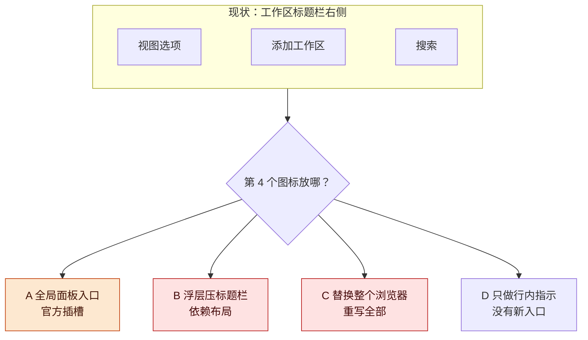
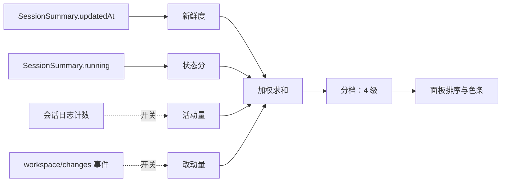
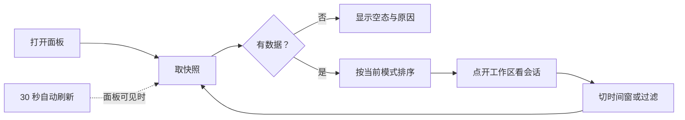
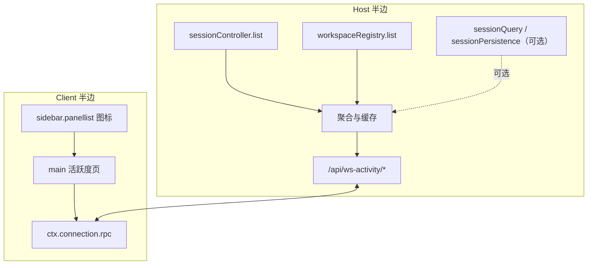

# 工作区活跃度显示讨论稿 v0.1.0

2026-10-23 · DSH 代理

## 版本与范围

插件能做，卡点不在数据而在入口：工作区标题栏右侧没有官方插槽，第 4 个图标必须在三种妥协里选一种；本稿建议先做「侧边栏全局面板入口 + 独立活跃度页」，数据先用现成的两项信号。

- 版本：v0.1.0 为首次整理。后续修改按补丁号递增（0.1.1、0.1.2…）。
- 主线：需求与现状 → 显示位置 → 活跃度模型 → 显示模式与交互 → 数据与架构 → 参考与未核实 → 风险与开放问题 → 待证命题与下一步。
- 状态标记：文中「已知」均来自本机 DSH 0.2.1-rc.2 的槽位清单、客户端源码与包 README 的核对；「提案」是本稿提出、尚未实现的部分，集中在最后一节。

**图 1　讨论主线 · 8 步、1 个关键分叉**

读图：从左到右是讨论推进顺序；橙色是真正的分叉点（入口位置），红色是当前证据缺口。

## 需求与现状

你要的四项活跃度口径里，「最近活动」和「运行状态」宿主已经现成，「活动量」和「文件改动」要读会话日志；工作区分组顺序不按活跃度排，这一条只能靠插件自己的页面实现。

需求复盘（来自 2026-10-23 的问答）：

- 口径：四项全要（最近活动、运行状态、活动量热度、文件改动）。
- 位置：工作区右侧的三个图标旁增加一个。
- 行为：给出两种可选项，未来可扩成多种。
- 时间窗：可配置，默认 24 小时。

| 现有能力 | 在哪 | 对需求的意义 |
| --- | --- | --- |
| 会话排序 Last updated / Manual | 工作区浏览器的视图选项，默认 Last updated，记住选择 | 会话行层面已有「最近活动」排序，但不是工作区层面的 |
| 工作区分组顺序 | Host 持久的手动顺序（拖拽） | 不按活跃度，插件要「组按活跃度排」必须换入口 |
| 行状态点 / 悬停卡 | 会话行（运行中、等待、完成未读、空闲；相对时间；悬停卡有扩展位） | 单会话状态可直接借鉴，但不是工作区总览 |
| 工作区标题栏三个图标 | 视图选项、添加工作区、搜索，硬编码在 ui-workspace | 没有插槽，第 4 个图标不能直接注册 |
| 全局面板入口 | `sidebar.panellist` 图标加标签 + `main` 页面 | 官方支持的「新入口」方式，当前部署没有注册任何面板 |

四项口径的数据可得性：

| 信号 | 数据源 | 采集成本 | 刷新 | 首版 |
| --- | --- | --- | --- | --- |
| 最近活动 | `SessionSummary.updatedAt`（最后一条用户消息或 steer） | 现成，一次列表调用 | 事件可订阅 | 上 |
| 运行状态 | `SessionSummary.running` 加 `api-session/status` 事件 | 现成 | 实时 | 上 |
| 活动量热度 | 会话日志里 user/message、tool/call 计数；token 在 assistant/message 的 usage | 每会话读日志 | 分钟级 | 开关 |
| 文件改动 | 会话日志 workspace/changes 事件的 files/added/deleted | 每会话读日志 | 分钟级 | 开关 |

## 显示位置

工作区标题栏是 ui-workspace 的内部 JSX，没有可注册的插槽；四个可选位置按「稳定性 ↔ 视觉符合度」排序，推荐 A，B 与 C 的代价写在表里。

| 方案 | 做法 | 稳定性 | 与「标题栏第 4 个图标」的符合度 | 维护成本 | 建议 |
| --- | --- | --- | --- | --- | --- |
| A 全局面板入口 | `sidebar.panellist` 注册图标加标签，`main` 注册整页 | 官方插槽，最稳 | 位置不同：在 New Session 下方，折叠栏里是图标 | 低 | 推荐先做 |
| B 浮层压标题栏 | `shell.overlay` 里渲染按钮，按标题栏位置定位 | 依赖布局；搜索展开、折叠、宽度变化都要跟 | 视觉一致 | 中高 | 不推荐，除非接受升级重做 |
| C 替换整个工作区浏览器 | 注册 `sidebar.workspaces` 单座，重写浏览区域 | 完全可控 | 一致，可含组内排序 | 最高 | 只在必须原生位置时选 |
| D 行内增强 | 会话行行首与悬停卡座位显示活跃度 | 官方插槽 | 不是新图标 | 低 | 作为 A 的补充 |

已核实的事实：

- `sidebar.workspaces` 的子插槽只有 5 个：Session 菜单项、行悬停按钮、目录流、行首座位、悬停卡扩展位；没有标题栏动作位。
- 标题栏代码在 `packages/client/ui-workspace/src/client/rows/WorkspaceBrowser.tsx:1331` 直接渲染 headerActions（视图选项加添加工作区），搜索是另一侧按钮。
- 新面板的官方范式是 `sidebar.panellist` 加 `main` 键控座，随包发布的两个例子是 ui-schedule 的任务管理器和 ui-plugin-manager。

**图 2　位置方案 · 1 个现状加 4 个分支**

读图：上面是现状，下面四个分支按代价从左到右升高；橙色是推荐项，红色是能做但代价最高的两条路。

## 活跃度模型

四项信号合成一个 0–100 分，但首版只算「最近活动 + 运行状态」，另外两项做成可开关的增强项，避免首版就背上全量日志扫描。

| 分项 | 算法 | 默认权重 |
| --- | --- | --- |
| 运行状态 | 运行中 1；等待用户 0.8（首版不接）；空闲 0 | 0.35 |
| 新鲜度 | exp(−Δt/τ)，τ 取时间窗的三分之一；窗口外记 0 | 0.35 |
| 活动量 | log1p(窗口内用户消息数加工具调用数) 除以 log1p(参考量) | 0.20 |
| 文件改动 | log1p(窗口内 changed files 加 added 加 deleted) 除以 log1p(参考量) | 0.10 |

- 分档：≥0.75 很活跃；0.45–0.75 活跃；0.15–0.45 偶尔；低于 0.15 沉寂。
- 工作区聚合：组内最高分乘 0.7 加组内平均乘 0.3。
- 说明：以上权重、分档线、参考量都是假设（数字为假设），全部进插件配置；「等待用户」要接审批与提问数据，首版先留分项位。

**图 3　信号流 · 4 个信号、2 个首版关闭**

读图：上排四个信号里带虚线的两条首版默认关闭；下排归一化后加权，最后只落到显示与排序，不回写 Host。

## 显示模式与交互

面板首版给两种排序模式（按活跃度、按最近活动），并保留后续模式位；时间窗与过滤都在面板内选，默认 24 小时。排序只影响这个面板，不写回工作区的持久顺序。

| 控件 | 选项 | 默认 | 说明 |
| --- | --- | --- | --- |
| 排序 | 按活跃度 / 按最近活动 /（扩展：按名称、按注册顺序） | 按活跃度 | 两种起步，控件本身是模式位 |
| 时间窗 | 1 小时 / 6 小时 / 24 小时 / 7 天 | 24 小时 | 影响新鲜度衰减与计数范围 |
| 过滤 | 全部 / 窗口内有活动 / 只看运行中 | 全部 | 只看运行中等于「此刻在动」 |
| 刷新 | 自动 30 秒加手动按钮 | 自动 | 面板不可见时停轮询 |

每行内容：工作区名、分档色条、运行中数量、最近活动相对时间、窗口内会话数；点开看会话明细（标题、状态、最近活动、可选计数）。

明确不做：不写回 Host、不改工作区手动顺序、不替换现有列表。

**图 4　交互流程 · 主线下钻加一条刷新回路**

读图：主线是打开、取快照、排序、下钻；下面的回路是切窗与刷新，面板不可见时自动刷新停止。

## 数据与架构

一个 Host 半边负责聚合，一个 Client 半边负责渲染；Client 只通过插件自己的一条 RPC 取快照，不读其他 UI 插件的内部状态。

- Host 半边：注入 `sessionController`、`workspaceRegistry`；可选注入 `sessionQuery`、`sessionPersistence`（做增量缓存）。注册两个 POST 端点：`ws-activity/snapshot`、`ws-activity/ping`。快照只汇总窗口内会话与运行中会话，其余略过。
- Client 半边：注册 `sidebar.panellist` 图标与 `main` 页面；文案走 locale（中文、英文）；控件自写，样式只用 `--dsw-alias-*` 主题令牌；通过 `ctx.connection.rpc.call("/api", "ws-activity/snapshot", payload)` 取数，这条 RPC 形态在 cfl-dag-panel 上跑通过。
- 缓存：每个会话按 `sessionPersistence` 的 revision 记一条增量缓存；首版只缓存窗口内会话。
- 只读：两端都不写会话、不改工作区、不发模型请求。

| 端点 | 请求 | 响应 |
| --- | --- | --- |
| `ws-activity/snapshot` | `{ windowMs, orderBy, filter }` | `{ generatedAt, workspaces: [{ id, title, path, score, band, runningCount, lastActivityAt, sessions: [{ sessionId, updatedAt, running, counts? }] }] }` |
| `ws-activity/ping` | `{}` | `{ ok: true, version }` |

**图 5　总体架构 · 两端加一条插件自己的 RPC**

读图：左边 Host 半边只读已有服务并聚合成快照，右边 Client 半边只负责入口与页面，中间只有一条插件自己的 RPC；虚线是可选的日志增强。

## 参考与未核实

现有形态的关键事实都能在这台机器的源码里核实；你提到的 Codex 设计我没有核实，需要你指认参考对象。

| 类别 | 代表 | 核实到的内容 | 缺口 |
| --- | --- | --- | --- |
| 工作区浏览器 | DSH ui-workspace（0.2.1-rc.2） | 两种会话排序、标题栏硬编码、5 个子插槽 | 工作区层面不按活跃度 |
| 面板注册范式 | ui-schedule、ui-plugin-manager | `sidebar.panellist` 加 `main` 键控座、locale、inject | 与工作区标题栏位置不同 |
| 同类插件先例 | cfl-dag-panel | 会话表头入口、`shell.overlay` 浮层、`/api` 下的 RPC 信封 | 没有活跃度类数据聚合 |
| Codex 的设计 | 待指认 | 未核实 | 桌面应用、CLI，还是某个仓库 |

仍未核实：Codex 的设计；DSH 后续版本里这些内部服务与插槽是否保持。说明：上表没有凭记忆写的条目，未核实的单列在表外。

## 风险与开放问题

- **入口位置不完全符合预期**：标题栏没有插槽，方案 A 不是第 4 个图标；B 与 C 能对上位置但有维护代价。对策：先用 A 把功能做成，位置再单独拍板。
- **评分可能好看不好用**：权重是假设。对策：首版只上两项可靠信号，界面显示分项，权重进配置。
- **日志扫描成本**：会话一多就慢。对策：按 revision 增量缓存、限制窗口内会话、单次上限加超时。
- **内部 API 不稳**：依赖 `sessionController` 等内部服务。对策：可选注入加失败降级，面板显示「Host 数据不可用」。
- **排序与手动顺序冲突**：对策：面板内排序不写回，工作区持久顺序保持不动。

开放问题：

- [ ] 入口位置：接受方案 A，还是选 B 或 C 并承担维护代价？
- [ ] Codex 参考对象具体是哪一份？
- [ ] 首版是否就要「活动量 + 文件改动」，还是留到 v1.1？
- [ ] 面板名称、图标风格和标签语言（中文、英文、双语）怎么定？

## 待证命题与下一步

最可能先出结果的是 P1（入口能不能真挂上）和 P2（现成数据够不够），下一步先把最小面板跑通，再谈评分好不好用。

| 编号 | 命题 / 猜想 | 已有依据 | 缺口 |
| --- | --- | --- | --- |
| P1 | Host RPC 加面板入口能在这台真机上跑通 | cfl-dag-panel 同形态跑通过 | 本插件未验证 |
| P2 | `sessionController.list` 的 updatedAt 与 running 足够撑起首版 | 服务契约与现有 UI 数据 | 真机耗时未量 |
| P3 | 按活跃度排序比按最近活动更符合直觉 | 无 | 需要你用真实工作区试一版 |
| P4 | 不读日志的首版会被长任务低估 | 运行状态能补一部分 | 无数据 |

下一步：

- [ ] 确认入口方案与 Codex 参考对象
- [ ] 建仓并搭 bundle 骨架（package.json、cordis.patch.yml、icon、locale）
- [ ] 实现 snapshot 端点与活跃度面板（两项信号）
- [ ] 用临时 profile 起真宿主做端点探针，再装进 desktop profile 看真机
- [ ] 24 小时窗口下做一次人工验收：你看一遍排序像不像
