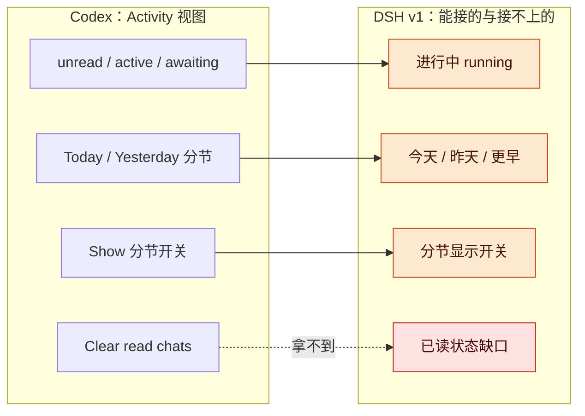
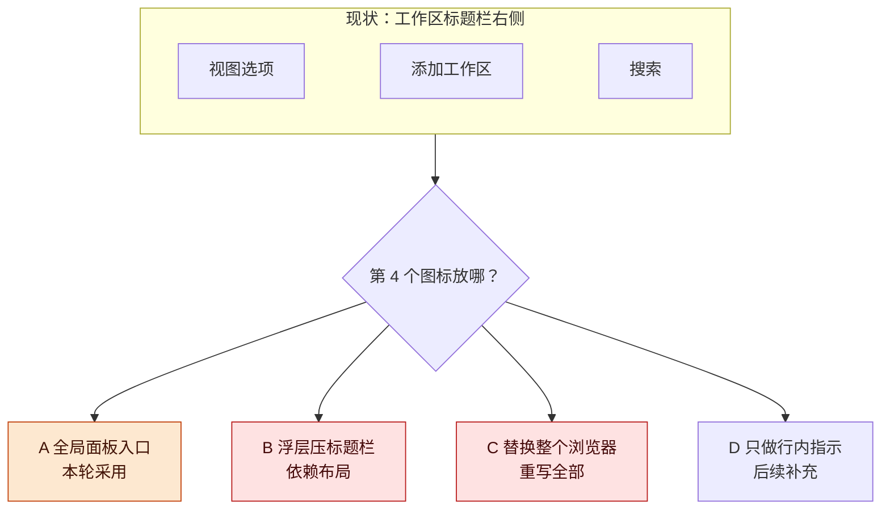
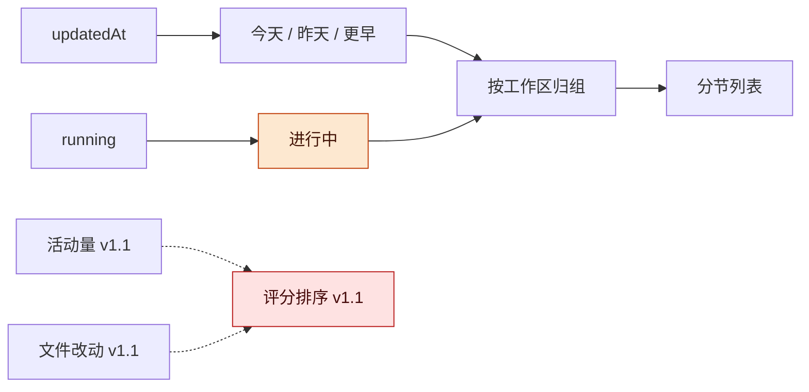
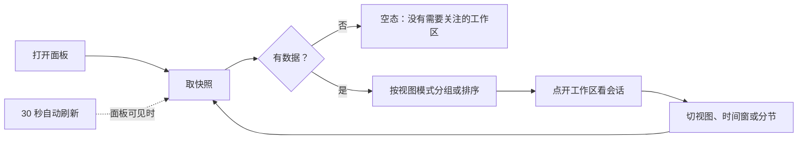
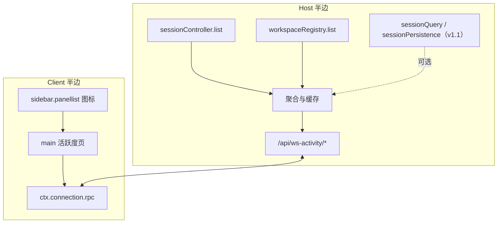

# 工作区活跃度显示讨论稿 v0.1.2

2026-10-23 · DSH 代理

## 版本与范围

插件能做，首版形态已定：侧边栏全局面板入口加活动分节视图（进行中、今天、昨天、更早），只吃现成的「最近活动 + 运行状态」两项信号；工作区标题栏那第 4 个图标的位置先不动，功能先做出来。

- 版本：v0.1.2 把「两种视图模式」落成具体两种（按工作区 / 按时间分节），并链到《工作区活跃度插件 · v0.1 实施稿》；v0.1.1 新增「已拍板与修正」「Codex 桌面应用的活跃度设计」两节，并据 Codex 的做法把首版主形态从综合评分改成状态分节；v0.1.0 为首次整理。后续修改按补丁号递增（0.1.3、0.1.4…）。
- 主线：已拍板与修正 → 需求与现状 → Codex 参考 → 显示位置 → 活跃度视图 → 交互 → 数据与架构 → 风险 → 下一步。
- 状态标记：文中「已知」都来自本机 DSH 0.2.1-rc.2 的槽位清单、客户端源码、包 README，以及本机 Codex 桌面应用 26.1016.61520 的界面文案；「提案」是本稿提出、尚未实现的部分。

**图 1　讨论主线 · 9 步、1 个新增依据**

读图：从左到右是本稿推进顺序；橙色是这一版新增的参考依据，红色是仍然空着证据的地方。

## 已拍板与修正

本轮（2026-10-23）拍板三件事：入口先按 A 做功能、参考对象锁定 Codex 桌面应用、首版只上两项现成信号；同时修正 v0.1.0 的核心提案——Codex 的活跃度视图走状态分节，不走综合评分。

| 问题 | 结论 | 依据 |
| --- | --- | --- |
| 第 4 个图标位置 | 先不定，先按 A（全局面板入口）做功能 | 你的回复「先不定，先做功能」；A 是唯一官方插槽 |
| 参考对象 | Codex 桌面应用 | 你的回复；本机 app.asar 界面文案已核实 |
| 首版信号 | 最近活动加运行状态 | 你的回复「两项现成信号」；两项都现成 |
| 时间窗 | 可配置，默认 24 小时 | 首轮问答 |
| 交互 | 两种选项起步，可扩成多种 | 首轮问答 |

**核实后的修正**：v0.1.0 说「四项信号合成 0–100 分，首版只算两项」；核实 Codex 的做法后改成——v1 主形态是状态分节视图，评分排序降为 v1.1，等四项信号齐再上。旧说法留在 git 历史的 v0.1.0 里。

## 需求与现状

你要的四项活跃度口径里，「最近活动」和「运行状态」宿主已经现成，「活动量」和「文件改动」要读会话日志；工作区分组顺序不按活跃度排，这一条只能靠插件自己的页面实现。

需求复盘（来自 2026-10-23 的问答）：

- 口径：四项全要（最近活动、运行状态、活动量热度、文件改动）。
- 位置：工作区右侧的三个图标旁增加一个。
- 行为：给出两种可选项，未来可扩成多种。
- 时间窗：可配置，默认 24 小时。

| 现有能力 | 在哪 | 对需求的意义 |
| --- | --- | --- |
| 会话排序 Last updated / Manual | 工作区浏览器的视图选项，默认 Last updated，记住选择 | 会话行层面已有「最近活动」排序，但不是工作区层面的 |
| 工作区分组顺序 | Host 持久的手动顺序（拖拽） | 不按活跃度，插件要「组按活跃度排」必须换入口 |
| 行状态点 / 悬停卡 | 会话行（运行中、等待、完成未读、空闲；相对时间；悬停卡有扩展位） | 单会话状态可直接借鉴，但不是工作区总览 |
| 工作区标题栏三个图标 | 视图选项、添加工作区、搜索，硬编码在 ui-workspace | 没有插槽，第 4 个图标不能直接注册 |
| 全局面板入口 | `sidebar.panellist` 图标加标签 + `main` 页面 | 官方支持的新入口方式，当前部署没有注册任何面板 |

四项口径的数据可得性：

| 信号 | 数据源 | 采集成本 | 刷新 | 首版 |
| --- | --- | --- | --- | --- |
| 最近活动 | `SessionSummary.updatedAt`（最后一条用户消息或 steer） | 现成，一次列表调用 | 事件可订阅 | 上 |
| 运行状态 | `SessionSummary.running` 加 `api-session/status` 事件 | 现成 | 实时 | 上 |
| 活动量热度 | 会话日志里 user/message、tool/call 计数；token 在 assistant/message 的 usage | 每会话读日志 | 分钟级 | 关，v1.1 |
| 文件改动 | 会话日志 workspace/changes 事件的 files/added/deleted | 每会话读日志 | 分钟级 | 关，v1.1 |

## Codex 桌面应用的活跃度设计

Codex 桌面应用把「活跃度」做成一个叫 Activity / Priority 的视图：用状态（未读、进行中、等待回复）筛出需要关注的聊天，按 Today / Yesterday 分节，而不是给每个会话算分。

| Codex 的做法 | 文案证据（本机 app.asar） | 对 DSH 的可用性 |
| --- | --- | --- |
| Priority 分节与 Activity 视图 | `sidebarElectron.priorityThreads` 为 Priority，`activityTitle` 为 Activity，`filterByPriority` 为 View activity；引导语是 See chats that are unread, active, or awaiting a response | DSH 有 running 可直接映射；unread 与 awaiting 当前拿不到 |
| 空态 | `priorityThreads.emptyState` 与 `unreads.empty` 都是 Nothing needs attention | 可直接借用 |
| 分节显示开关 | `priorityThreads.showSection` 为 Show，可选项 Pinned / Priority / Scheduled / Chat / Work；另有 `restoreDefaults` | 映射成「显示哪些分节」，配恢复默认 |
| 清理动作 | `priorityThreads.refresh` 为 Clear read chats，`markAllAsRead` 为 Mark all as read | DSH 没有已读状态，v1 不做 |
| 行状态芯片 | `localTaskRow.awaitingApproval` 为 Awaiting approval，`needsInput` 为 Needs input，`systemError`，定时任务标记 | DSH 行内已有状态点与等待提示；插件面板 v1 只显示运行中 |
| 工作区悬停计数 | `projectHoverCard.activeCount` 为 {count} active，另有 waiting 与 unread 计数 | v1 可做 active 与今日会话数，waiting 与 unread 待数据源 |
| 排序菜单 | `sortMenu.created`、`manual`、`updated`，即 Created / Manual order / Last updated | DSH 现有 Last updated / Manual；插件面板补「按最近活动」与后续「按活跃度」 |

**图 2　Codex 到 DSH 的映射 · 4 个设计元素、3 条能接**

读图：左边是 Codex 的四个设计元素，右边是 DSH v1 的映射；三条实线能直接落地，虚线那条缺数据源，标成红框。

## 显示位置

工作区标题栏是 ui-workspace 的内部 JSX，没有可注册的插槽；本轮按 A 执行（先做功能），B 与 C 的代价留在表里，位置以后再单独评估。

| 方案 | 做法 | 稳定性 | 与「标题栏第 4 个图标」的符合度 | 维护成本 | 本轮 |
| --- | --- | --- | --- | --- | --- |
| A 全局面板入口 | `sidebar.panellist` 注册图标加标签，`main` 注册整页 | 官方插槽，最稳 | 位置不同：在 New Session 下方，折叠栏里是图标 | 低 | 采用 |
| B 浮层压标题栏 | `shell.overlay` 里渲染按钮，按标题栏位置定位 | 依赖布局；搜索展开、折叠、宽度变化都要跟 | 视觉一致 | 中高 | 暂缓 |
| C 替换整个工作区浏览器 | 注册 `sidebar.workspaces` 单座，重写浏览区域 | 完全可控 | 一致，可含组内排序 | 最高 | 暂缓 |
| D 行内增强 | 会话行行首与悬停卡座位显示活跃度 | 官方插槽 | 不是新图标 | 低 | 作为后续补充 |

已核实的事实：

- `sidebar.workspaces` 的子插槽只有 5 个：Session 菜单项、行悬停按钮、目录流、行首座位、悬停卡扩展位；没有标题栏动作位。
- 标题栏代码在 `packages/client/ui-workspace/src/client/rows/WorkspaceBrowser.tsx:1331` 直接渲染 headerActions（视图选项加添加工作区），搜索是另一侧按钮。
- 新面板的官方范式是 `sidebar.panellist` 加 `main` 键控座，随包发布的两个例子是 ui-schedule 的任务管理器和 ui-plugin-manager。

**图 3　位置方案 · 1 个现状加 4 个分支**

读图：上面是现状，下面四个分支按代价从左到右升高；橙色是本轮采用项，红色是能做但代价最高的两条路。

## 活跃度视图

v1 面板给两种视图模式：「按工作区」（默认，工作区按活跃度排名，展开看会话）与「按时间」（进行中、今天、昨天、更早四个分节）；v1.1 再引入四项信号的综合评分与排序。落地细节见[实施稿](../implementation/工作区活跃度插件-实施稿-2026-10-23.md)。

| 分节 | 判定 | 组内排序 |
| --- | --- | --- |
| 进行中 | `running` 为真，不看时间窗 | 最近活动倒序 |
| 今天 | 本地日期等于今天 | 最近活动倒序 |
| 昨天 | 本地日期等于昨天 | 最近活动倒序 |
| 更早 | 时间窗内其余会话 | 最近活动倒序 |

- 工作区归属：会话按 `workspaceRegistry` 的 `sessionIds` 归到工作区；没有归属的会话放「未分组」。
- 分档色条（v1 可选）：只区分「有运行中会话」「今天有活动」「更早」，不引入分数。
- v1.1 评分：两项信号阶段用 `0.55 × 运行状态 + 0.45 × 新鲜度`；四项信号齐后按 v0.1.0 的 0.35 / 0.35 / 0.20 / 0.10 权重（数字为假设，全部进配置）。
- 说明：分节边界用本机时区，跨日按本地 00:00 切。

**图 4　信号流 · v1 用两条实线，v1.1 补两条虚线**

读图：实线是 v1 的全部逻辑，虚线是 v1.1 才接的评分；红色框是还没有数据的两项信号。

## 交互与显示模式

v1 面板给两种视图模式（按工作区、按时间分节），默认按工作区；时间窗默认 24 小时，分节可开关，空态与恢复默认按 Codex 的习惯做。落地细节见[实施稿](../implementation/工作区活跃度插件-实施稿-2026-10-23.md)。

| 控件 | 选项 | 默认 | 说明 |
| --- | --- | --- | --- |
| 视图模式 | 按工作区 / 按时间分节 | 按工作区 | 两种起步，控件本身是模式位 |
| 按时间分节 | 进行中 / 今天 / 昨天 / 更早 | — | 分节内按最近活动倒序 |
| 时间窗 | 1 小时 / 6 小时 / 24 小时 / 7 天 | 24 小时 | 影响纳入范围与计数 |
| 过滤 | 全部 / 只看运行中 | 全部 | 只看运行中等于「此刻在动」 |
| 分节开关 | 进行中 / 今天 / 昨天 / 更早 | 全开 | 对应 Codex 的 Show，配恢复默认 |
| 刷新 | 自动 30 秒加手动按钮 | 自动 | 面板不可见时停轮询 |

每行内容：工作区名、运行中数量、最近活动相对时间、窗口内会话数；点开看会话明细（标题、状态、最近活动）。

空态：没有需要关注的工作区（借 Codex 的 Nothing needs attention）。

明确不做：不写回 Host、不改工作区手动顺序、不替换现有列表、不做已读标记。

**图 5　交互流程 · 主线下钻加一条刷新回路**

读图：主线是打开、取快照、分节、下钻；下方回路是切窗与刷新，面板不可见时自动刷新停止。

## 数据与架构

一个 Host 半边负责聚合，一个 Client 半边负责渲染；Client 只通过插件自己的一条 RPC 取快照，不读其他 UI 插件的内部状态。

- Host 半边：注入 `sessionController`、`workspaceRegistry`；可选注入 `sessionQuery`、`sessionPersistence`（v1.1 做增量缓存）。注册两个 POST 端点：`ws-activity/snapshot`、`ws-activity/ping`。快照只汇总窗口内会话与运行中会话，其余略过。
- Client 半边：注册 `sidebar.panellist` 图标与 `main` 页面；文案走 locale（中文、英文）；控件自写，样式只用 `--dsw-alias-*` 主题令牌；通过 `ctx.connection.rpc.call("/api", "ws-activity/snapshot", payload)` 取数，这条 RPC 形态在 cfl-dag-panel 上跑通过。
- 只读：两端都不写会话、不改工作区、不发模型请求。

| 端点 | 请求 | 响应 |
| --- | --- | --- |
| `ws-activity/snapshot` | `{ windowMs, view, orderBy }` | `{ generatedAt, workspaces: [{ id, title, path, runningCount, lastActivityAt, sessions: [{ sessionId, updatedAt, running }] }] }` |
| `ws-activity/ping` | `{}` | `{ ok: true, version }` |

**图 6　总体架构 · 两端加一条插件自己的 RPC**

读图：左边 Host 半边只读已有服务并聚合成快照，右边 Client 半边只负责入口与页面，中间只有一条插件自己的 RPC；虚线是 v1.1 才接的日志增强。

## 风险与开放问题

- **入口位置未定**：本轮先按 A；如果最终要标题栏图标，还得回来评估 B 与 C 的代价。对策：A 的功能与入口分离，位置单独改。
- **v1 只有两项信号**：拿不到已读与等待回复，活跃度偏「最近在动」。对策：分节视图先把「在进行」讲清楚，评分与增强信号放 v1.1。
- **分节边界争议**：本地时区、跨日、窗口外都可能有人有意见。对策：规则写死进文档，时间窗可配置。
- **内部 API 不稳**：依赖 `sessionController` 等内部服务。对策：可选注入加失败降级，面板显示「Host 数据不可用」。
- **排序与手动顺序冲突**：对策：面板内排序不写回，工作区持久顺序保持不动。

开放问题：

- [ ] A 的面板入口能否作为长期位置（接受后再正式否掉 B 与 C）？
- [ ] 已读与等待回复有没有官方数据源，v1.1 能不能接上？
- [ ] v1.1 的评分与两项增强信号什么时候做？
- [ ] 面板命名、图标风格和标签语言（中文、英文、双语）怎么定？

## 待证命题与下一步

最可能先出结果的是 P1（入口能不能真挂上）与 P2（两项信号够不够像活跃度），下一步先把最小面板跑通，再谈评分。

| 编号 | 命题 / 猜想 | 已有依据 | 缺口 |
| --- | --- | --- | --- |
| P1 | Host RPC 加面板入口能在这台真机上跑通 | cfl-dag-panel 同形态跑通过 | 本插件未验证 |
| P2 | 两项信号加状态分节就够像「活跃度」 | Codex 的 Activity 视图以状态为主 | DSH 缺已读与等待数据 |
| P3 | 状态分节比综合评分更符合你的直觉 | Codex 的做法 | 需要你用真实工作区看一版 |
| P4 | 24 小时窗口与本地日界切分符合预期 | 无 | 需要真实数据看 |

下一步：

- [ ] 建仓并搭 bundle 骨架（package.json、cordis.patch.yml、icon、locale）
- [ ] Host 半边：snapshot 端点（两项信号）
- [ ] Client 半边：按工作区与按时间两种模式、空态与分节开关
- [ ] 用临时 profile 起真宿主做端点探针，再装进 desktop profile 看真机
- [ ] 24 小时窗口下做一次人工验收：你看一遍分节像不像
