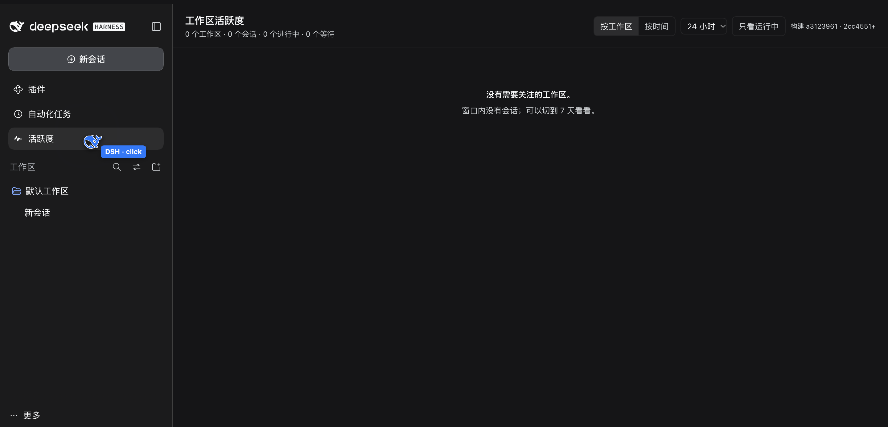
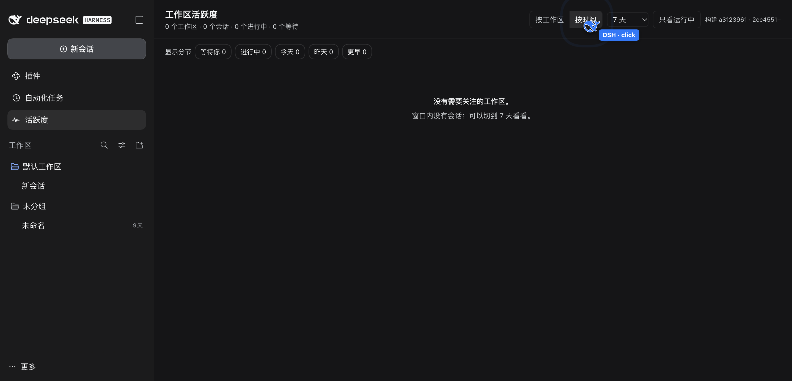

# S3 证据：一次性 profile 探针 + 浏览器可视验证（2026-10-23）

状态：**探针 8/8 通过；可视验证在一次性实例里通过；填充态可视验证未覆盖（见「未覆盖」）。**

## 1. 一次性 profile 探针（`node scripts/live-probe.mjs`）

原始输出：[probe-2026-10-23.log](./probe-2026-10-23.log)

| # | 检查 | 结果 | 数值/证据 |
| --- | --- | --- | --- |
| P1 | App 内置 CLI 把本仓装进一次性 web profile | PASS | `+ dsh-workspace-activity 0.1.0 <- /Users/taishuo/projects/dsh-workspace-activity` |
| P2 | 一次性宿主启动并打印带 token 的 URL | PASS | `http://127.0.0.1:63008`（端口随机） |
| P3 | host 只监听 127.0.0.1 | PASS | 127.0.0.1 |
| P4 | token URL 换到登录 cookie | PASS | status 303 |
| P5 | boot graph 里有本插件的 client 行 | PASS | status 200 · 包名在 HTML 里 |
| P6 | client bundle 被服务且形状正确 | PASS | status 200 · combo 1,949,436 bytes（多包拼接；本包 33,880 bytes） · `__ModuleLoader__.load` 存在 |
| P7 | bundle 与服务端构建章一致 | PASS | id `a3123961` |
| P8 | 无 cookie 打开页面被认证拦住 | PASS | status 401（client bundle 是公开静态资源，无 cookie 也 200，不是信任边界） |

关键事实（省得下次再查）：

- 本包的 client bundle 在 **combo URL** 里（`/plugins/??a/client.js,b/client.js&rev=…`），不是 `/plugins/<包名>/client.js`；探针从 HTML 里抠出包含本包的那条 combo。
- 本机 App 内置 CLI 的路径在 `app.asar` 内，**普通 node 的 `existsSync` 看不见**（asar 虚拟路径），只用 Electron 二进制以 `ELECTRON_RUN_AS_NODE=1` 启动才读得到；探针因此只检查 App 二进制存在。

## 2. 浏览器可视验证（一次性实例）

做法：`node scripts/live-probe.mjs --keep --state /tmp/wsa-probe/state.json`，用它打印的 token URL 在会话浏览器里打开、操作、截图；结束后按 state 里的 pid 整组杀进程并删临时 `DSH_HOME`（验证过无残留进程与目录）。

| 检查 | 结果 | 证据 |
| --- | --- | --- |
| 侧边栏出现「活跃度」入口（本包面板行） | PASS | 见下图，入口在「插件」「自动化任务」之后，带脉冲图标 |
| 点开主区显示面板、不丢当前会话 | PASS | 见下图 |
| 两种视图模式切换 | PASS | 按工作区 ↔ 按时间；按时间出现五个分节 chip（等待你/进行中/今天/昨天/更早，各带计数） |
| 时间窗选择 | PASS | 24 小时 → 7 天 |
| 只看运行中开关 | PASS | aria-pressed 切换 |
| 空态文案 | PASS | 「没有需要关注的工作区。窗口内没有会话；可以切到 7 天看看。」 |
| 视图偏好持久化（localStorage） | PASS | 切到「按时间 + 7 天」后刷新页面，再点入口仍是「按时间 + 7 天」 |
| console 无本插件错误 | PASS | `chrome_console` 无条目 |
| 面板不泄主题 | PASS | 全部颜色走 `--dsw-alias-*`；暗色下可读 |

**图 1　按工作区（默认）· 一次性实例、空数据**

读图：侧边栏「活跃度」被选中；主区是面板本体（标题、总数、模式切换、时间窗、只看运行中、构建章、空态）。

**图 2　按时间分节 · 同样的空数据**

读图：多出的「显示分节」一行为五个分节 chip，各自计数；空态不变。

## 3. 未覆盖 / 已知限制

1. **填充态可视验证没有做过**：一次性实例没有自己的会话；试过把一条真实冷会话日志拷进临时 `DSH_HOME`，宿主列表给的 `updatedAt` 回落到 `createdAt`（约 9 天前），24 小时与 7 天窗口都把它滤掉——面板显示空态，这本身符合窗口规则，但「有行」的渲染只被纯函数单测覆盖，没在浏览器里看过。**这一项留给 S4 的真机 + 用户确认。**
2. **运行中 / 等待你 两种状态没在浏览器里造出来**：需要能发 prompt 的模型，一次性实例没有凭据。逻辑由 17 条纯函数单测覆盖（`effectiveStatus`、分节优先级）。
3. 一次性实例的欢迎弹窗/登录弹窗会遮页面，验证时手动关掉；不影响插件。
