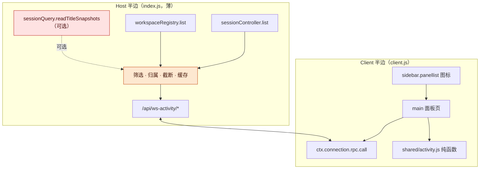
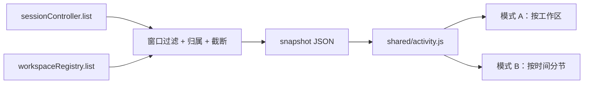
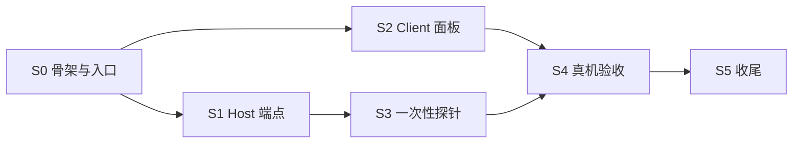
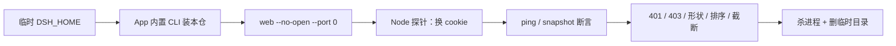

# 工作区活跃度插件 · v0.1 实施稿：官方面板入口 + 活动视图，先读后写

> 本稿只管 v0.1 怎么做、按什么顺序、每片拿什么判。设计取舍在
> [讨论稿 v0.1.1](../discussion/工作区活跃度显示讨论稿-v0.1.1.md)（下称「讨论稿」），本稿不重复，只写它没写到的。
>
> 句子标注：【实查】= 读码或读产物得到，带出处；【判断】= 我的意见。

## 〇、出口

在 desktop profile 里刷新页面后，侧边栏出现「活跃度」入口，点开主区是活动视图；「按工作区」与「按时间」两种模式、时间窗、过滤、分节开关都能用；数据与真实运行状态一致；Host 数据不可用时面板显示明确错误；卸载后入口消失。

三态表（任一未量 = INCOMPLETE，不许写"已交付"）：

| # | 判据 | 怎么量 | 三态 |
| --- | --- | --- | --- |
| E1 | 侧边栏出现「活跃度」入口（宽栏与折叠栏都在） | `Slots.listSubTree` 里看到 `sidebar.panellist` 有本插件条目；用户在真机确认两种状态 | 未量 |
| E2 | 点开主区显示面板，点回会话正常 | 用户操作；`Slots.listSubTree` 里 `main` 有同名 key | 未量 |
| E3 | 「进行中」与真实运行状态一致 | 跑一个会话，面板 30 秒内出现它；用户对拍 | 未量 |
| E4 | 工作区归属与侧边栏分组一致 | 抽查 3 个工作区，对拍会话数与分组 | 未量 |
| E5 | 控件都生效（模式、窗口、过滤、分节开关） | 逐项操作并记录 | 未量 |
| E6 | 空态与 Host 不可用错误态可显示 | 单测注入空数据/错误；错误态另用探针覆盖 | 未量 |
| E7 | 只读：两端没有任何写操作 | 代码审查（无 `session.append`、无工作区写、无模型请求） | 未量 |
| E8 | 卸载后入口消失、无残留 | `remove_bundle` 后刷新页面，`Slots` 里无条目 | 未量 |

## 一、开工时的现状（2026-10-23）

- 仓库只有 README 与讨论稿 v0.1.1，**没有代码**。【实查】`git log` 两笔提交
- 目标 profile 是 `~/.dsh/profiles/desktop`（DSH 0.2.1-rc.2 桌面 App）；profile 的 `cordis.patch.yml` 里**没有**本插件条目。【实查】`~/.dsh/profiles/desktop/package.json`
- `sidebar.panellist` 与 `main` 当前**没有任何面板注册**：随包发布的两个示例面板（定时任务、插件管理）在本 profile 未启用。【实查】`Slots.listSubTree`：`main` 的 key 只被 `conversation` 占用
- 应用内置 CLI 路径：`/Applications/DeepSeek Harness.app/Contents/Resources/app.asar/dsh/node_modules/@deepseek-ai/dsh-desktop-host/lib/cli.js`；全局 `dsh` 是 0.2.0-rc.2，**不要混用**。【实查】`ps` 输出与 [dsh-chrome A0 记录](https://github.com/TaiShuo150622/dsh-chrome/blob/main/docs/DSH-SIDEBAR-NATIVE.md)
- 浏览器插件已用真宿主证明：第三方包声明 `dsh.client` 后，client bundle 能被真实 DSH 加载并注册插槽（右栏 tab 注册 PASS）。本插件只需要 `sidebar.panellist` + `main`，不需要右栏 tab。【实查】同上 §6.0.1
- 客户端 bundle 是懒加载：执行 bundle 只注册 factory，模块体在 materialization 时才跑；`dsh.client.immediately: true` 让该行在启动时加载。【实查】[client-modules README](https://github.com/deepseek-harness/deepseek-harness/blob/main/packages/client/modules/README.md)
- 数据源：`sessionController.list()` 返回 `SessionSummary[]`（`updatedAt` / `running` / `blank` / `origin` / `cwd` / `projections`）；`workspaceRegistry.list()` 返回 `Workspace[]`（`title` / `path` / `sessionIds`）。【实查】服务契约（`cordis_inspect_query`）
- `/api` 精确路由 + 登录 cookie 的用法在 cfl-dag-panel 上跑通过：Host 用 `ctx.connection.fetch.register`，Client 用 `ctx.connection.rpc.call`。【实查】`/Users/taishuo/projects/crypto_factor_lab/web/dsh-plugin/node/index.js`
- **验证盲区**：桌面 App 的 web 端口随机、token 不打印，浏览器扩展抓不到它的页面；真机可视验收要靠用户刷新页面后看。【实查】[dsh-chrome README](https://github.com/TaiShuo150622/dsh-chrome)「桌面 App 的端口是随机的、token 不打印」

## 二、从浏览器插件接过来的教训

结论：大部分能靠「更小的接口面 + 一次性 profile 探针 + 失败可降级」避开；有一类避不开——DSH 的插件 API 是内部契约，升级会碎，只能锁版本、降级、留回归清单。

| # | 教训 | 在浏览器插件里的样子 | 本插件的规避动作 | 能避开吗 |
| --- | --- | --- | --- | --- |
| L1 | DSH 内部 API 无稳定性承诺 | [风险表 R1/R13](https://github.com/TaiShuo150622/dsh-chrome/blob/main/docs/DSH-SIDEBAR-NATIVE.md) | 锁 0.2.1-rc.2；只依赖 2 个已核实的插槽 + 2 个服务；升级回归清单（§六 6.4）；失败 fail-soft | 只能缓解 |
| L2 | 第三方包的 `dsh.client` 在 bundle 安装方式下可能不被扫描 | 风险 R2 列为中/高，A0-1 才证明能加载 | S0 第一件事就是验证入口出现；失败退路：手装脚本（symlink + patch，学 cfl-dag-panel）或请上游支持 | 能避开（靠 A0） |
| L3 | 桌面 App 端口随机、token 不打印，自动化拿不到页面 | 每次验收都要人开页面 | 一次性 `DSH_HOME` + App 内置 CLI `web --no-open --port 0`，Node 探针自己换 cookie；不碰用户 profile、不嗅 token | 能避开 |
| L4 | 混用 CLI 版本 | 全局 `dsh` 与 App 内置 CLI 不是同一版 | 探针脚本硬编码 App 内置 CLI 路径，并打印它报的版本 | 能避开 |
| L5 | 手改 profile patch 会把 GUI 弄坏 | 写坏 `cordis.patch.yml` 会让 GUI 起不来 | 安装只走 `plugin_manager install_bundle`；一次性 profile 的安装脚本自带备份、校验、回滚 | 能避开 |
| L6 | 裸注册 HTTP 路由绕过信任闸门 | 无 cookie 也能打进来，或 401/403 边界不清 | 只用 `connection.fetch.register` 精确路由；401/403/415 单测 | 能避开 |
| L7 | 读别人插件的 DOM/样式估位置、碰 `root` 单座 | 会错位；`root` 单座还会反赢把整页挤掉 | 只用声明的两个插槽，不读 DOM；不碰 `root`；位置争议按讨论稿走 | 能避开 |
| L8 | iframe 嵌 DSH Web 认证走不通 | HttpOnly + SameSite=Strict + `sec-fetch-site` 闸门，实测 401 | 本插件不嵌页面；面板是 React 组件；验证也不建 iframe | 能避开 |
| L9 | client bundle 一崩，插槽只剩 console 一行 | `slot entry crashed` | factory 顶层零副作用；渲染防御；S0/S3 检查 console；组件内不写全局 DOM | 能避开 |
| L10 | 热更后新旧两半对不上 | dag-panel 专门做了构建号章 + `health` | `ping` / `snapshot` 带 build id；面板页脚显示「构建 · 数据年龄」；README 写清改哪类文件怎么生效 | 能避开 |
| L11 | 大文件 + 隐式策略（`WRITE_TOOLS` 那种） | headless.js 3652 行、工具集合靠硬编码名单 | 文件行数预算（§三）；策略表显式导出；纯函数进 `shared/` 可单测 | 能避开 |
| L12 | 真机验收用"看起来对"代替 | A0 表里 NOT RUN 的项一度被当成 PASS 讨论 | 三态表 + 记录数值（延迟、计数、payload 字节）；未量不写已交付 | 能避开 |
| L13 | 单测覆盖不到端到端 | dag-panel 承认搜索/换焦点没有自动化尺子 | 端点层有 Node 探针端到端（cookie → RPC → payload 断言）；UI 层靠纯函数单测 + 人工 checklist | 只能部分（UI 仍要人看） |
| L14 | 资源/轮询长挂 | 后台面板继续截图、截图文件堆积 | 30 秒轮询、`document.hidden` 停、无后台任务、无落盘 | 能避开 |

**主动不做的事**（对应上面教训）：不新增模型工具、不写会话/工作区、不做设置页、不替换现有列表、不碰 `root`、不读别人的 DOM。v0.1 的接口面就 **2 个端点 + 2 个插槽**。

## 三、架构与文件

结论：Host 半边只做聚合与缓存（薄），所有分节、排序、过滤逻辑在 Client 半边的纯函数里；中间只有一条插件自己的 RPC。

**图 1　总体架构 · 2 个插槽、1 条 RPC、2 个端点**



读图：左边 Host 半边只读已有服务并聚合成一份快照，右边 Client 半边只负责入口、页面与纯函数；虚线是可选的标题增强，缺了不影响主流程。

| 文件 | 职责 | 行数预算 |
| --- | --- | --- |
| `package.json` | 包声明：`exports`、`dsh.bundle.patch`、`dsh.client`（`platform: web`、`immediately: true`） | ≤ 45 |
| `cordis.patch.yml` | 一条 `insert` 行，`id` 与包名同名 | 5 |
| `index.js` | Host 半边：`apply(ctx, config)`、`inject: ['connection']`、可选服务、端点、缓存 | ≤ 180 |
| `shared/activity.js` | 纯函数：请求校验、窗口过滤、工作区归属、截断、分节、排序（两端共用） | ≤ 200 |
| `client/panel.js` | Client 源码：图标组件、面板页、控件、样式 | ≤ 450 |
| `client.js` | Client 构建产物（`scripts/build-client.mjs` 生成并提交） | 生成 |
| `scripts/build-client.mjs` | 把 `shared` + `client` 源码拼成 bundle，盖 build 章 | ≤ 90 |
| `scripts/live-probe.mjs` | 一次性 profile 探针（§六 6.1） | ≤ 220 |
| `tests/activity.test.mjs` | 纯函数单测（`node --test`） | ≤ 250 |
| `locale/en.json`、`locale/zh.json` | 面板文案 + 插件 `meta` | 各 ≤ 60 |
| `icon.svg` | 原创图标（脉冲折线） | — |

**为什么 Client 要一个构建脚本**：client bundle 的 `factory` 只认宿主给的外部 `require`，不能解析相对 ESM import；而纯函数又要能被 Node 单测直接 import。所以 `shared/activity.js` 用 ESM 写、单测直接 import；构建脚本按固定顺序拼 `shared` → `client/panel.js`，剥掉 `export` 与那一行允许的 import。脚本里加断言：client 源码除 `../shared/activity.js` 外不得 import 别的相对路径。

**硬约束**（违反任何一条就是设计错）：不 require Harness 的 Client 包（含 `ui-primitives`）；不注册 `root`；不读其他插件的 DOM/样式；不新增模型工具；不写任何会话或工作区状态。

## 四、契约

### 4.1 端点

两条精确路由，加端点要同步 `ENDPOINTS` 数组（cfl-dag-panel 的老坑）。

| 端点 | 方法 | 作用 |
| --- | --- | --- |
| `/api/ws-activity/ping` | POST | 返回 build 章与版本，用来判断前后端是不是同一次构建 |
| `/api/ws-activity/snapshot` | POST | 返回聚合快照 |

信封沿用宿主 `/api` 的形状（与 cfl-dag-panel 一致）：

```jsonc
// 请求
{ "type": "client-request", "rpcId": "x", "method": "ws-activity/snapshot", "payload": { ... } }
// 响应
{ "type": "server-response", "rpcId": "x", "result": { "ok": true, "value": { ... } } }
{ "type": "server-response", "rpcId": "x", "result": { "ok": false, "error": { "code": "unavailable", "message": "…", "details": {} } } }
```

`snapshot` 请求：

```jsonc
{ "windowMs": 86400000 }   // 可选；clamp 到 [1h, 30d]，缺省取插件配置（24h）
```

`snapshot` 响应（`value`）：

```jsonc
{
  "build": { "id": "…", "at": "2026-10-23T…" },
  "generatedAt": 1761000000000,
  "windowMs": 86400000,
  "truncated": false,
  "totals": { "workspaces": 6, "sessions": 23, "running": 2 },
  "workspaces": [{
    "id": "…", "title": "…", "path": "/Users/…",
    "runningCount": 1, "lastActivityAt": 1760999990000, "sessionCount": 5,
    "sessions": [{ "id": "…", "title": "…", "updatedAt": 1760999990000, "running": true }]
  }],
  "ungrouped": null   // 或与 workspaces 同形状的一桶
}
```

**筛选与归属规则**（全部进 `shared/activity.js`，逐条能单测）：

| 规则 | 值 | 依据 |
| --- | --- | --- |
| 跳过 `blank` 会话 | 是 | 空白会话不是活动 |
| 跳过 `origin === 'subagent'` 会话 | 是 | 随包侧边栏同样隐藏它们【实查】ui-workspace README |
| 保留条件 | `running` 为真，或 `updatedAt >= now - windowMs` | 进行中的不因窗口被藏掉 |
| 工作区归属 | `workspace.sessionIds` 成员关系；不按 `cwd` 猜 | 注册表已按规范路径过滤 |
| 未归属会话 | 放 `ungrouped` 桶 | 不丢数据 |
| 空工作区 | 不返回（窗口内没有会话的工作区不占版面） | 【判断】避免噪声 |
| 截断 | 会话总数超 `maxSessions`（默认 400）时保留最新，`truncated: true` | 防 payload 失控 |
| 排序（Host 侧） | 工作区按 `lastActivityAt` 倒序；会话按 `updatedAt` 倒序 | 客户端仍会按模式重排 |

标题：优先 `summary.projections.values.title`；空则用可选 `sessionQuery.readTitleSnapshots`；再空则 `null`，由客户端显示短 id。三条都拿不到时面板仍可用。

### 4.2 客户端：两种视图模式与纯函数

讨论稿写的「两种视图模式（活动分节 / 单列排序）」在拆任务时落成下面两种（差异写在这里，讨论稿 v0.1.2 同步）：

| 模式 | 顶层 | 行 | 排序 |
| --- | --- | --- | --- |
| A 按工作区（默认） | 工作区 | 工作区名 + `运行中 N` + 今日/窗口内会话数 + 最近活动相对时间；展开看会话 | 运行中会话数降序，再 `lastActivityAt` 降序，再会话数降序 |
| B 按时间 | 进行中 / 今天 / 昨天 / 更早 | 会话行（所属工作区名 + 状态点 + 相对时间） | 节内 `updatedAt` 倒序 |

- 时间窗只影响「纳入范围」，不改变分节规则；分节边界用浏览器本地时区 00:00，跨日按本地日期。
- 过渡到 B 模式时，「进行中」永远在前；「更早」是窗口内其余。
- 过滤：全部 / 只看运行中（两种模式都生效）。
- 分节开关（B 模式）：四个分节可隐藏，`恢复默认` 一键还原；选择存 `localStorage`（键带插件前缀）。
- 行点击：`ctx.get('uiWorkspace')?.openSession(id)`；服务不可用时行不可点，面板显示一行提示，不假装成功。
- 空态：没有需要关注的工作区（附「切到 7 天」快捷项）。
- 错误态：`Host 数据暂不可用：<code>` + 重试键；有旧数据时保留旧数据并标「数据是 X 分钟前」。

### 4.3 数据流

**图 2　数据流 · 服务 → 快照 → 纯函数 → 两种模式**



读图：宿主侧只做一次聚合，客户端拿同一份快照派生两种视图；切换模式不发第二次请求。

## 五、切片

| 片 | 做什么 | 判据（怎么算完） | 依赖 |
| --- | --- | --- | --- |
| S0 | 骨架与入口验证：`package.json`、`cordis.patch.yml`、空 `index.js`、静态图标与占位面板、locale、icon、README、build 脚本骨架 | `install_bundle` 后侧边栏出现「活跃度」；`Slots` 里能看到注册；点开是占位页；刷新后仍在；console 无本插件错误 | — |
| S1 | Host 端点：`index.js` 真实实现 + `shared/activity.js` + 端点 + 错误码 + 缓存 + 单测 | 单测全绿（含 §六 6.2 能红的负向）；探针 `ping`/`snapshot` 200；无 cookie 401；坏 Origin 403 | S0 |
| S2 | Client 面板：两种模式、控件、跳转、空态/错误态、主题令牌、构建号与数据年龄 | 纯函数单测全绿；真机面板可操作；暗色/亮色正常（用户确认） | S1 定型契约后可与 S1 并行 |
| S3 | 一次性 profile 端到端探针：`scripts/live-probe.mjs` | 探针 0 退出；输出记录延迟、payload 字节、会话数 | S1 |
| S4 | 真机安装与人工验收：装进 desktop profile、用户刷新、过 12 条 checklist、修缺陷 | 出口表全转 ✅ + 用户确认 | S2、S3 |
| S5 | 收尾：README（安装/卸载/开发循环/升级清单）、CHANGELOG、工作记录、提交推送 | 新人能照文档复现；记录里有命令与输出 | S4 |

**图 3　切片依赖 · S1 与 S2 在契约冻结后可并行**



读图：S0 先把最可能碎的「第三方包能不能挂上」验掉；S1 与 S2 以本稿 §四 契约并行；S3 只依赖 S1，S4 要两条都过。

**图 4　一次性 profile 探针流程 · 不碰用户 profile**



读图：整个过程在 `/tmp` 下的一次性 profile 里，token 只用于探针自己；不读写用户 profile，也不嗅桌面 App 的 token。

## 六、验证计划

### 6.1 一次性 profile 探针（S3）

| # | 检查 | 怎么做 | 期望 |
| --- | --- | --- | --- |
| P1 | App 内置 CLI 可用 | `ELECTRON_RUN_AS_NODE=1 <App>/…/dsh-desktop-host/lib/cli.js plugin --profile web add <repo>`（`DSH_HOME=/tmp/…`） | 输出含 `+ dsh-workspace-activity` |
| P2 | 临时宿主起来 | 同 CLI `web --no-open --port 0` | 打印 `http://127.0.0.1:<port>/?token=…`；记录版本 |
| P3 | 客户端 bundle 被服务 | 带 cookie `GET /plugins/<pkg>/client.js` | 200；内容含 `__ModuleLoader__.load` 与包名 |
| P4 | 路由信任边界 | 无 cookie POST → 401；`Origin: http://evil` → 403；`GET` → 405/415 | 全部符合 |
| P5 | `ping` | 带 cookie POST `ws-activity/ping` | `{ ok: true, value: { build: { id, at } } }` |
| P6 | `snapshot` 形状与不变量 | 带 cookie POST；断言字段齐全、无 subagent、无 blank、running 一定在、会话倒序 | 全部通过 |
| P7 | 性能与体积 | 连打 20 次 `snapshot`，记 p50/p95 与响应字节数 | 记录数值；首版目标 p95 < 300ms（假设，窗口内 ≤ 300 会话） |
| P8 | 清理 | 杀宿主、删临时 `DSH_HOME` | 无残留进程，目录删除 |

探针输出写进 `docs/implementation/probe-<日期>.log`（或工作记录附件），数字必须能回看。

### 6.2 单测（能红的断言）

| 破坏 | 必须红的用例 |
| --- | --- |
| 不按 `origin` 过滤 subagent | `test_subagent_sessions_are_not_listed` |
| 没跳过 `blank` | `test_blank_sessions_are_not_listed` |
| 窗口过滤把 running 也滤掉 | `test_running_sessions_outside_the_window_stay_visible` |
| 没按 `updatedAt` 倒序 | `test_sessions_are_newest_first` |
| 用 `cwd` 猜归属而不是 `sessionIds` | `test_membership_comes_from_the_registry` |
| 截断不置标记 / 留下最旧 | `test_truncation_sets_the_flag_and_keeps_newest` |
| 非法窗口不拒绝 | `test_invalid_windows_are_refused` |
| 分节用 UTC 而不是本地 00:00 | `test_buckets_use_local_midnight` |
| 跨月昨天算错 | `test_yesterday_across_month_boundary` |
| 空范围不返回空态标记 | `test_empty_scope_yields_empty_state` |
| 模式 A 排序没把运行中提前 | `test_running_workspaces_lead_in_mode_a` |

### 6.3 真机人工验收（S4，用户操作）

1. 侧边栏出现「活跃度」入口，宽栏与折叠栏都在。
2. 点开主区显示面板，不丢当前会话。
3. 跑一个会话，面板 30 秒内把它放进「进行中」。
4. 切「按时间」能看到今天/更早分节；「进行中」置顶。
5. 时间窗切 1 小时/7 天，纳入范围随之变化。
6. 过滤「只看运行中」后只剩运行中。
7. 分节开关能隐藏分节，恢复默认能还原。
8. 点会话行能跳到该会话。
9. 窗口内没数据时出现空态文案。
10. 暗色/亮色都清楚，长标题不撑破行。
11. 刷新页面后入口与面板状态仍在。
12. 卸载后入口消失。

### 6.4 DSH 升级回归清单（写进 README）

升级 DSH 后逐项对：`sidebar.panellist` / `main` 插槽 key 与注册选项；`dsh.client` 扫描是否仍接受第三方 bundle；`/api` 精确路由与 cookie；`SessionSummary` / `Workspace` 字段；`uiWorkspace` 服务名；面板入口与 console。任何一项碎掉：先 `set_bundle` 关掉插件，再按 README 修，不硬改宿主。

## 七、进度（开工后填）

| 片 | 状态 | 证据 |
| --- | --- | --- |
| S0 | 未开始 | — |
| S1 | 未开始 | — |
| S2 | 未开始 | — |
| S3 | 未开始 | — |
| S4 | 未开始 | — |
| S5 | 未开始 | — |

## 八、这一期不做

- 活动量（消息/工具调用/token）与文件改动 —— v1.1。
- 综合评分与「按活跃度」排序键 —— v1.1。
- 侧边栏行内指示（`sidebar.session.row.leading` / `hover`）—— v1.2 候选。
- 已读、等待回复、清理已读等 Codex 式动作 —— 数据源未找到。
- 标题栏第 4 个图标（方案 B/C）—— 位置另评，不混进本期。
- 设置页、模型工具、写路径、替换现有列表 —— 不做。

## 九、做完之后的优化

用户 2026-10-23：「做完之后你也可以优化它」。优化按「先量后改」排，每项仍走本稿的切片/判据/三态：

| 优化项 | 触发条件 | 预期收益 |
| --- | --- | --- |
| 分片缓存（按 `sessionPersistence` revision 增量） | 探针 p95 > 300ms 或会话数 > 500 | 降延迟 |
| v1.1 活动量 + 文件改动 + 评分排序 | v0.1 验收通过后 | 活跃度更完整 |
| 行内指示（leading/hover 座位） | 用户希望不开面板也能看 | 日常可见 |
| 入口位置评估（B/C） | 用户仍想要标题栏图标 | 位置对齐 |
| 已读/等待数据源研究 | 找到官方数据源 | Codex 式完整视图 |
| 键盘导航、选择持久化、刷新节流 | 用户高频使用后 | 顺手 |

三项原则：每项先量（延迟/字节/操作次数），再改，再量；不为了"看起来优雅"重写；优化项不做提前承诺，按讨论稿补丁迭代。
